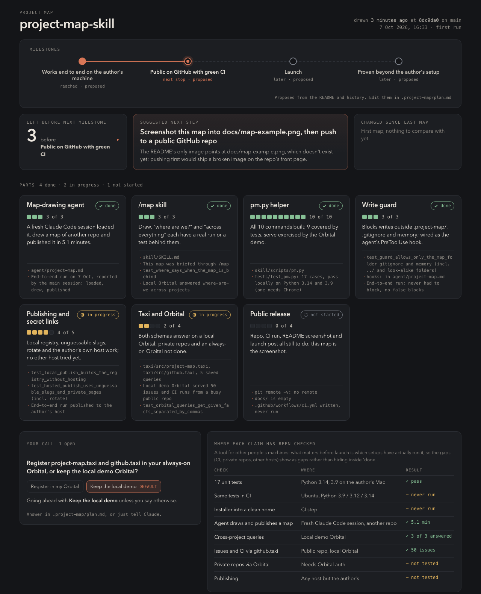
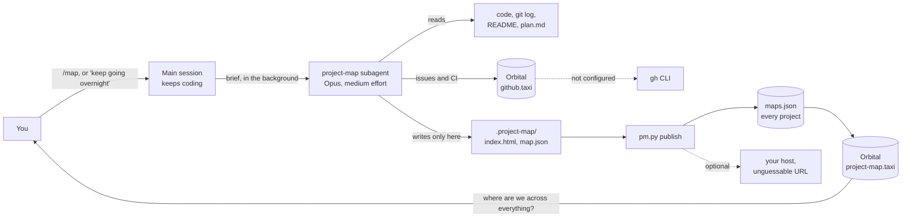

# project-map

**Know where a long Claude Code run got to, at a glance.**

Leave Claude Code working overnight and the morning question is always "where are we?". The answer is somewhere in hours of transcript.

project-map gives Claude a subagent whose only job is to draw a map of the project: one HTML file showing the parts the project breaks into, how far each has got, what's stuck and what it's waiting on, and what happens next. It draws in the background while the main session keeps coding, and redraws after every milestone. In the morning you open one file, or ask "where are we?" and Claude answers from the map.

It also speaks [Taxi](https://taxilang.org), so [Orbital](https://orbitalhq.com) can answer "where are we across every project?" in one query, and the agent can read issues and CI through Orbital instead of hard-coding each source.



## What every map shows

- **Parts.** 3 to 8 of them, each `done`, `in progress`, `not started` or `stuck`, with counted progress ("4 of 5", never a guessed percentage) and the evidence behind it: a commit, a test, an issue, a CI run. A stuck part says what it's waiting on.
- **The top strip.** How many things are left before the next milestone, the suggested next step and why, and which parts changed since the last map (also highlighted on their cards).
- **Your call.** Questions only you can answer, each with the default Claude will take if you don't. It keeps going with the default and says so in the next map.
- **Milestones.** Proposed from your README and commit history the first time, then yours to edit in `.project-map/plan.md`.
- **One to three panels picked for the project.** A rollout gate, a test matrix, a deploy checklist. There's no template.

The map is a single self-contained HTML file: no network requests, opens with a double-click, works on a phone.

## How it fits together



## Install

You need Claude Code 2.1 or later, Python 3.9+ and git. `gh` (issues and CI without Orbital), Chrome (the agent checks its own map at phone and laptop width) and Docker (the Orbital demo) are optional.

```bash
git clone https://github.com/jhammant/project-map-skill.git
cd project-map-skill
./install.sh
```

`install.sh` links the `/map` skill into `~/.claude/skills/map`, writes the `project-map` agent to `~/.claude/agents/`, and creates `~/.config/project-map/config.json`. The agent preloads whichever design skills you have installed (`frontend-design`, `impeccable`); choose them yourself with `PROJECT_MAP_SKILLS="frontend-design:frontend-design,dataviz" ./install.sh`. Re-run it after a `git pull`. Start a new Claude Code session so it picks up the agent.

It installs as files rather than as a plugin on purpose: plugin subagents ignore hooks, and the write guard below is a hook.

## Use

```text
/map                                  draw the first map (asks dark or light and one accent colour, once, ever)
where are we?                         answered from the map, with a note if the map is behind HEAD
where are we across everything?       every project, through Orbital if you have one
/map open | /map link | /map rotate   open it, show its hosted link, or replace a link that was shared too widely
```

To make Claude do this on its own, add this to `~/.claude/CLAUDE.md`:

```markdown
## Project maps (long autonomous runs)

- Before running on your own for a long stretch (overnight, "keep going", a backlog), have the **project-map** subagent draw a map in the background (`/map`), then keep coding; don't wait for it.
- After every milestone, have project-map update the map, in the background.
- When I ask "where are we?" or "what's left?", answer from the map, not from memory.
- Follow the map's suggested next step. Put anything that needs my call in the map's "Your call" panel with a default; if I don't answer, go ahead with the default and say so in the next update.
```

## Hosting with unguessable links (optional)

Maps stay on your machine unless you set a publish command. With one, each project's map is published at a URL containing a 20-character random token (100 bits), the same idea as a "share by link" document: anyone with the link can read it, nobody can find it. Published pages carry `noindex` and `no-referrer`, so search engines skip them and browsers don't pass the address on. `/map rotate` gives a project a new link and, if you set a remove command, takes the old one down.

Any static host works. `{dir}` is a folder holding `public/` (the files) and an `hl.json`; `{public}` is that `public/` folder; `{slug}` is the secret path. Two examples:

```json
{
  "publish": {
    "command": "rsync -a --delete {public}/ me@example.com:/var/www/maps/{slug}/",
    "remove": "ssh me@example.com rm -rf /var/www/maps/{slug}",
    "url": "https://example.com/maps/{slug}/",
    "prefix": "map"
  }
}
```

```json
{
  "publish": {
    "command": "aws s3 sync {public} s3://my-maps-bucket/{slug} --delete",
    "remove": "aws s3 rm s3://my-maps-bucket/{slug} --recursive",
    "url": "https://maps.example.com/{slug}/"
  }
}
```

Every publish also refreshes an index of all your projects at its own secret link, with the `maps.json` Orbital reads. That index link opens every map, so treat it like a password. Don't publish anything you'd mind leaking: a map summarises the project, including what's stuck and the decisions waiting on you.

## Orbital and Taxi

`taxi/` is a [Taxi](https://taxilang.org) project with two schemas.

**Emitting: `project-map.taxi`** describes `map.json`, and every published map lands in one `maps.json`, so Orbital can query them all:

```bash
python3 skill/scripts/pm.py orbital where-are-we   # every project: next milestone, things left, next step
python3 skill/scripts/pm.py orbital stuck          # every stuck part and what it waits on
python3 skill/scripts/pm.py orbital your-calls     # every open decision and its default
```

```taxiql
find { projectmap.ProjectMap[] } as {
  project : projectmap.ProjectName
  stuck : projectmap.MapPart[].filter((projectmap.PartStatus) -> projectmap.PartStatus == "stuck") as {
    part : projectmap.PartName
    waitingOn : projectmap.WaitingOn
  }[]
}[]
```

Each map in `maps.json` also says which folder it is (`folder`, typed `projectmap.ProjectFolder`), the name other tools know the project by even when the map has its own title. A schema that takes a folder name can then join straight onto your maps: [Retrace](https://github.com/jhammant/retrace)'s, for instance, adds your hands-on time per project.

**Using: `github.taxi`** describes GitHub issues and Actions runs. The agent runs `pm.py github OWNER/REPO`, which asks Orbital first and falls back to the `gh` CLI; its `source` field says which answered. Any other issue tracker or CI system with a Taxi schema can feed the map the same way, without changing the agent.

Both schemas call placeholder hosts (`projectMaps`, `githubApi`) that each Orbital maps to real URLs in `services.conf`, so nothing private lives in the schema.

Point `projectMaps` at a host root: `pm.py serve` (`http://host.docker.internal:9733` from Docker) or a host that serves `maps.json` at `/maps.json`. The open-source Orbital keeps a path in a `services.conf` URL, but some commercial builds keep only the host, so a URL like `https://example.com/maps-<token>` silently reads the wrong page there. `pm.py serve` runs well as a login item or daemon.

**Try it locally:**

```bash
python3 skill/scripts/pm.py serve --host 0.0.0.0 &      # serves ~/.local/share/project-map/maps.json
cd examples/orbital && docker compose up -d             # Orbital on http://localhost:9022 with taxi/ loaded
ORBITAL_URL=http://localhost:9022 python3 ../../skill/scripts/pm.py orbital where-are-we
```

For private repositories, give Orbital a GitHub token through its authentication settings; the schema doesn't change.

## Safety

- **The agent can only write its own files.** A `PreToolUse` hook (`pm.py guard`) blocks any Write or Edit outside `.project-map/`, the project's `.gitignore` (it adds one line, `.project-map/`) and the agent's own memory. It normalises `../` first and rejects look-alike folders. Hooks can't path-limit shell commands, so the agent's instructions limit Bash to reading (git log, git status) and `pm.py`.
- **It reports evidence, not guesses.** Every status names its evidence; "done" means something shows it works. The agent doesn't run your tests or builds.
- **Secret links stay private.** They live in `~/.config/project-map/links.json`, mode 0600.

## Files

| Where | What |
|---|---|
| `<project>/.project-map/index.html` | The map. |
| `<project>/.project-map/map.json` | The data, in the shape `project-map.taxi` describes; `pm.py check` validates it. |
| `<project>/.project-map/plan.md` | Milestones and your answers. Edit freely; the agent never overwrites your lines. |
| `<project>/.project-map/log.md` | One line per map: when, why, what changed. |
| `~/.config/project-map/config.json` | `publish` (command, remove, url, prefix) and `orbital.url`. |
| `~/.local/share/project-map/maps.json` | Every project's latest map, for `where --all` and Orbital. |
| `~/.claude/agent-memory/project-map/` | Your style and what the agent learned about each project. |

## Development

```bash
python3 -m pytest -q tests     # 17 tests; the preview test needs Chrome and skips without it
```

## Credits

The idea comes from a tip doing the rounds: before you leave Claude running overnight, have it draw a project map and give it a subagent that only draws maps. This is that, built out, with a write guard, unguessable hosting and Taxi.

## Licence

[MIT](LICENSE)
